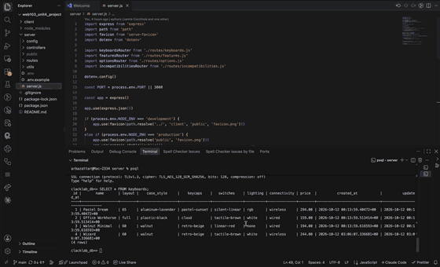

# WEB103 Project 4 - *ClackLab*

Submitted by: **Arbaz Attar**

About this web app: **ClackLab is a custom mechanical keyboard builder. Pick a layout (60% up to full-size), a case material and finish, a keycap colorway, switches, lighting and connectivity, and a live SVG preview plus a running price update with every click. Builds are saved to a Render PostgreSQL database through an Express REST API, and can be viewed, edited and deleted from both the list page and the detail page. Impossible combinations (a walnut case with underglow, Hall-effect switches on a wireless board, pudding keycaps with no backlight, and so on) are greyed out before you submit, flagged in red if an earlier change makes a selected option invalid, and rejected by the server with a clear message if a conflicting build is ever submitted.**

Time spent: **X** hours

## Required Features

The following **required** functionality is completed:

<!-- Make sure to check off completed functionality below -->
- [x] **The web app uses React to display data from the API.**
- [x] **The web app is connected to a PostgreSQL database, with an appropriately structured `CustomItem` table.**
  - [ ]  **NOTE: Your walkthrough added to the README must include a view of your Render dashboard demonstrating that your Postgres database is available**
  - [ ]  **NOTE: Your walkthrough added to the README must include a demonstration of your table contents. Use the psql command 'SELECT * FROM tablename;' to display your table contents.**
- [x] **Users can view **multiple** features of the `CustomItem` (e.g. car) they can customize, (e.g. wheels, exterior, etc.)**
- [x] **Each customizable feature has multiple options to choose from (e.g. exterior could be red, blue, black, etc.)**
- [x] **On selecting each option, the displayed visual icon for the `CustomItem` updates to match the option the user chose.**
- [x] **The price of the `CustomItem` (e.g. car) changes dynamically as different options are selected *OR* The app displays the total price of all features.**
- [x] **The visual interface changes in response to at least one customizable feature.**
- [x] **The user can submit their choices to save the item to the list of created `CustomItem`s.**
- [x] **If a user submits a feature combo that is impossible, they should receive an appropriate error message and the item should not be saved to the database.**
- [x] **Users can view a list of all submitted `CustomItem`s.**
- [x] **Users can edit a submitted `CustomItem` from the list view of submitted `CustomItem`s.**
- [x] **Users can delete a submitted `CustomItem` from the list view of submitted `CustomItem`s.**
- [x] **Users can update or delete `CustomItem`s that have been created from the detail page.**

The following **optional** features are implemented:

- [x] Selecting particular options prevents incompatible options from being selected even before form submission

The following **additional** features are implemented:

- [x] The SVG preview re-renders for every feature: key layout (60% / 65% / TKL / full-size), case material and finish (plastic, anodized aluminum, walnut grain, frosted acrylic), keycap colorway, backlight and underglow, and a coiled cable versus a wireless indicator
- [x] Incompatibility rules are stored in their own PostgreSQL table and served by the API, so the client and the server enforce exactly the same rules. The server also recomputes the price from the options table before saving, so the stored price can never drift from the selected options
- [x] Features, options and rules all live in the database (`features`, `options`, `incompatibilities`) and are fetched through `/api/features`, `/api/options` and `/api/incompatibilities`, so the catalog can change without touching the frontend
- [x] A build sheet on the detail page itemizes the base price and every option's price
- [x] Delete confirmation dialog, loading / empty / error states, a sticky preview and price panel, and a responsive layout that works at phone width
- [x] `npm run reset` recreates every table and seeds the features, options, rules and three sample keyboards

## Video Walkthrough

Here's a walkthrough of implemented required features:

<!-- Replace this with whatever GIF tool you used! -->
GIF created with Kap

## Notes

**Running it locally**

1. `npm install`
2. Create a Postgres database on Render, copy `server/.env.example` to `server/.env` and fill in the connection values from the Render dashboard (for a local Postgres, add `PGSSL=false`).
3. `npm run reset` to create and seed the tables.
4. `npm run dev` to start Vite on port 5173 and the Express API on port 3000.

**Challenges**

- Incompatibility rules had to work in both directions without making an invalid build unreachable. I made each rule directional (while option A is selected, option B is disabled) so a user can never click into a conflict, but changing an earlier choice can still invalidate a selected option. That option turns red with a note, the submit shows the full error list, and the API rejects the request as well.
- `case` is a reserved word in SQL, so the keyboards table stores that feature as `case_style` and the API aliases it back to `case` so it lines up with the feature slug the client uses.
- Rendering several keyboard previews on the list page meant SVG gradient and filter ids collided. Each preview now namespaces its ids with React's `useId`.
- Render's Postgres requires SSL while a local Postgres does not, so the pool config reads a `PGSSL` flag from the environment.

## License

Copyright 2026 Arbaz Attar

Licensed under the Apache License, Version 2.0 (the "License"); you may not use this file except in compliance with the License. You may obtain a copy of the License at

> http://www.apache.org/licenses/LICENSE-2.0

Unless required by applicable law or agreed to in writing, software distributed under the License is distributed on an "AS IS" BASIS, WITHOUT WARRANTIES OR CONDITIONS OF ANY KIND, either express or implied. See the License for the specific language governing permissions and limitations under the License.
